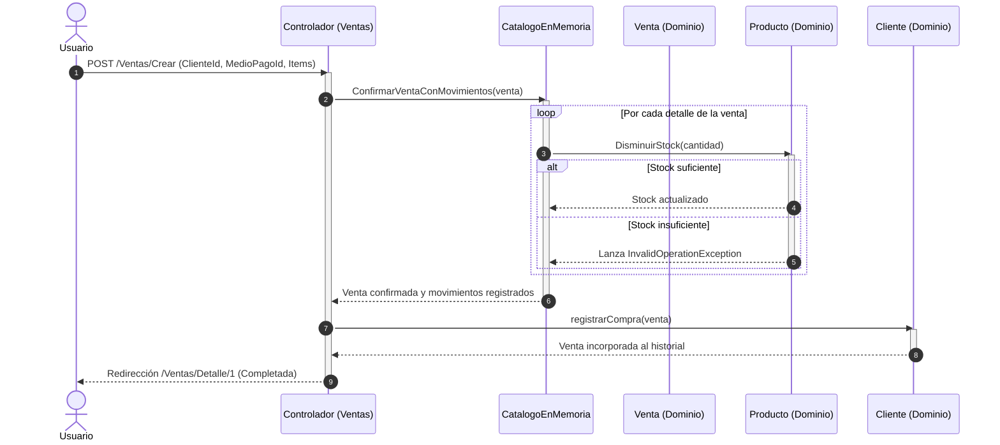

# Diagrama de Secuencia: Registrar y Confirmar Venta

Este diagrama modela la interacción sincrónica entre la capa web y las entidades del dominio al confirmar una venta, actualizando las existencias del catálogo y el historial del cliente.

